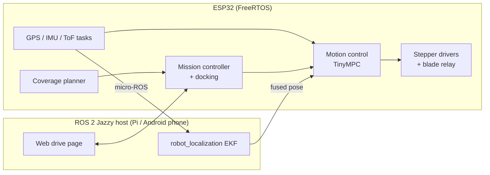

<div align="center">

# GreenTitan

**An open-source robotic lawnmower you 3D-print yourself, with RTK GPS navigation, for well under $1000.**

[](LICENSE)


</div>

## Why

Commercial RTK robot mowers are expensive, and the open-source projects I found give you either software for a machine you have to buy, or a printed shell with no software. GreenTitan aims to give you both: printable mechanics, the firmware and host software, and the docs to build one yourself.

## Features

- **RTK GPS localization.** A `robot_localization` EKF fuses RTK position with the gyro. GPS heading is only trusted while the mower is clearly moving; there is no compass and no wheel odometry in the pose.
- **Coverage planning.** Outline laps plus straight-row infill, planned on the mower (Clipper2), so the body never swings past the lawn edge.
- **Path tracking with MPC.** Rounded-corner paths followed by a TinyMPC controller running on the ESP32.
- **ToF wall assist.** Two VL53L8CX sensors let the mower follow walls, fences and hedges while you drive it by hand, to record the lawn outline.
- **Automatic docking.** The mower learns where the charging station is over RTK and keeps refining that estimate on every dock and undock.
- **Web drive page.** Joystick, live 2D/3D map and mission control in the browser, from a laptop or a phone.
- **Hardware-in-the-loop simulation.** The real firmware runs on the ESP32 against a Gazebo model of the mower. Only the sensor and motor drivers are swapped.

## How it works



## Hardware

| Part | Used here |
|---|---|
| Frame | 2020 aluminium extrusion and 3D-printed parts |
| Drive | 2× NEMA23 steppers with 10:1 planetary gearboxes, DM542T drivers |
| Blade | MY1016-type DC motor on a relay |
| GNSS | u-blox C94-M8P RTK board ([pick your region's variant](https://www.u-blox.com/en/product/c94-m8p)) |
| IMU / ranging | MPU6050, 2× VL53L8CX time-of-flight |
| Power | Einhell 18 V Power X-Change battery |
| Host | Raspberry Pi, moving to an old Android phone |

Full details, pinout and print rules: [docs/HARDWARE.md](docs/HARDWARE.md).

## Repository layout

| Path | Contents |
|---|---|
| [`src/`](src) | ESP32 firmware (PlatformIO, Arduino, FreeRTOS) |
| [`ros2_ws/src/robot_package`](ros2_ws/src/robot_package) | ROS 2 host: EKF config, launch files, web drive page |
| [`ros2_ws/src/sim_env`](ros2_ws/src/sim_env), [`greentitan_sim`](ros2_ws/src/greentitan_sim) | Gazebo simulation and HIL worlds |
| [`tools/`](tools) | Drive tests, wall-assist bench, Android phone setup |
| [`cad/`](cad) | Fusion 360 and render scripts for design studies |
| [`docs/`](docs) | [Architecture](docs/ARCHITECTURE.md) and [hardware](docs/HARDWARE.md) docs |

## Getting started

Flash the firmware:

```bash
pio run -e esp32dev -t upload
```

Start the micro-ROS agent and the ROS 2 host (Jazzy):

```bash
docker run -it --rm -v /dev:/dev --privileged --net=host \
  microros/micro-ros-agent:jazzy serial --dev /dev/ttyUSB0 -b 921600
cd ros2_ws && colcon build --packages-select robot_package && source install/setup.bash
ros2 launch robot_package robot.launch.xml
```

The firmware waits at boot until the agent answers. For the Gazebo hardware-in-the-loop setup, see [docs/ARCHITECTURE.md §11](docs/ARCHITECTURE.md#11-simulation-and-test-switches-definitionsh).

## Status

GreenTitan is under active development and is the subject of my final thesis.

- ✅ Field-tested on the first drive train: RTK localization and line following
- ✅ In HIL simulation: full mowing missions, MPC tracking, wall assist, automatic docking
- 🚧 In progress: Mower V3 rebuild with geared drive, the cover, moving the ROS 2 host to a phone
- ⏳ Not yet: battery sensing on the real mower, rain sensor, obstacle handling in missions, camera use

## Credits

**Models**
- u-blox C94-M8P case with openings, by Scorbin ([CC BY 4.0](https://www.thingiverse.com/scorbin/designs))
- Einhell battery adapter, by Hans ([GPL v3](https://www.printables.com/social/193091-hans/about))

**Software and references**
- Receiving UBX NAV messages: [iforce2d](https://www.youtube.com/watch?v=TwhCX0c8Xe0)
- PID controller: [Philip Salmony](https://github.com/pms67)

**Libraries**
- [TinyMPC](https://tinympc.org) (MIT), vendored and patched for the ESP32
- [Clipper2](https://github.com/AngusJohnson/Clipper2) by Angus Johnson (Boost Software License)
- [Adafruit MPU6050](https://github.com/adafruit/Adafruit_MPU6050), [ContinuousStepper](https://github.com/bblanchon/ArduinoContinuousStepper), [STM32duino VL53L8CX](https://github.com/stm32duino/VL53L8CX), [micro-ROS for PlatformIO](https://github.com/micro-ROS/micro_ros_platformio)

## License

[GNU GPL v3](LICENSE)
