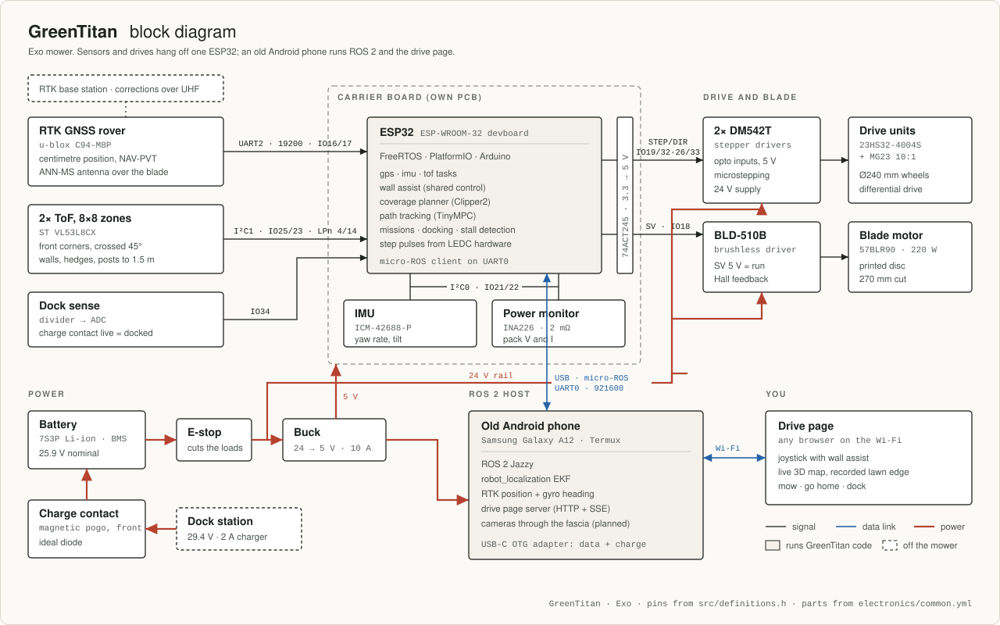

<div align="center">

# GreenTitan

**An open-source robotic lawnmower you 3D-print yourself. RTK GPS navigation, for well under $1000.**

[](LICENSE)


</div>

Commercial RTK robot mowers are expensive and closed. The open-source projects I found give you either software for a machine you have to buy, or a printed shell with no software. GreenTitan is both: a printable mower built from parts you can order, the firmware and host software that drive it, and the docs to build one yourself.

## What it does

- **Centimetre positioning.** An RTK GPS fix, fused with the gyro in a `robot_localization` EKF. GPS heading is only trusted while the mower is clearly moving. No compass, and no wheel odometry in the pose: plastic wheels slip on grass.
- **Records your lawn as you drive it.** Steer with the joystick on the drive page. The ToF wall assist is always on: it keeps the body off walls, fences and hedges and follows them, so the outline comes out clean.
- **Plans and mows on its own.** Outline laps plus straight-row infill (Clipper2), tracked by a TinyMPC controller running on the ESP32. About 2 cm off the path on the rows in simulation.
- **Finds its dock.** Dock it by hand once and it learns where the station is over RTK, then keeps refining that on every dock and undock.
- **Tested in a simulator before the lawn.** Gazebo hardware-in-the-loop runs the real board with the same firmware. Only the sensor and motor drivers are simulated.

## How it fits together



The ESP32 owns everything that acts: missions, planning, motion control and the motors. The phone only estimates the pose and serves the drive page. If the link drops, the mower stops.

## The Exo mower

The next mower, **Exo** (proposed, 2026-11-10), is a clean-slate design modelled in CadQuery ([`cad/exo`](https://github.com/KristijanPruzinac/GreenTitan/tree/cad/clean-slate-redesign/cad/exo) on the `cad/clean-slate-redesign` branch). `build.py` checks every part before export: nothing clashes, every printed part fits a 245 mm bed and prints without supports, every part comes off in a straight line past its neighbours, and every frame bolt sits on a free slot.

| | |
|---|---|
| Size | 503 × 385 × 240 mm, about 14.5 kg |
| Frame | 2020 aluminium extrusion on 90° brackets |
| Printed parts | 12 (9 different), green and black, no supports |
| Drive | 2× 23HS32 NEMA 23 steppers with MG23 10:1 gearboxes, DM542T drivers, Ø240 mm printed wheels |
| Blade | 57BLR90 brushless motor on a BLD-510B driver, printed disc with pivoting razor blades, 270 mm cut |
| Positioning | u-blox C94-M8P RTK rover, ICM-42688-P gyro on the carrier board |
| Walls | 2× ST VL53L8CX 8×8 time-of-flight, crossed 45° across the nose |
| Power | 7S Li-ion pack (25.9 V), INA226 current sensing, e-stop, magnetic charge contact at the front |
| Brain | ESP32 on its own carrier board, plus an old Android phone (Galaxy A12) running ROS 2 |

Every bought part goes in as bought: nothing to cut, drill or machine, so it can be rebuilt with a printer and hand tools. The ESP32 is flashed through the phone, so there is no USB-UART adapter on the mower. The battery, gyro, INA226 and some small parts are still to buy. Pinout, wiring and print rules are in [docs/HARDWARE.md](docs/HARDWARE.md).

## Getting started

Flash the firmware:

```bash
pio run -e esp32dev -t upload
```

Start the micro-ROS agent and the ROS 2 host (Jazzy, Linux):

```bash
docker run -it --rm -v /dev:/dev --privileged --net=host \
  microros/micro-ros-agent:jazzy serial --dev /dev/ttyUSB0 -b 921600
cd ros2_ws && colcon build --packages-select robot_package && source install/setup.bash
ros2 launch robot_package robot.launch.xml
```

The firmware waits at boot until the agent answers. Then open the drive page at `http://<host ip>:8080/`. To run the host on an old Android phone instead, see [tools/android](tools/android/README.md). For the Gazebo hardware-in-the-loop setup, see [docs/ARCHITECTURE.md](docs/ARCHITECTURE.md#11-simulation-and-test-switches-definitionsh).

## Repository layout

| Path | Contents |
|---|---|
| [`src/`](src) | ESP32 firmware (PlatformIO, Arduino, FreeRTOS) |
| [`ros2_ws/src/robot_package`](ros2_ws/src/robot_package) | ROS 2 host: EKF config, launch files, drive page |
| [`ros2_ws/src/sim_env`](ros2_ws/src/sim_env), [`greentitan_sim`](ros2_ws/src/greentitan_sim) | Gazebo simulation and test worlds |
| [`tools/`](tools) | Drive tests, wall-assist bench, Android phone setup |
| [`docs/`](docs) | [Architecture](docs/ARCHITECTURE.md) and [hardware](docs/HARDWARE.md) |

## Status

GreenTitan is under active development and is the subject of my final thesis.

- ✅ **Field-tested** on the first drive train: RTK localization and line following. That drive was too weak for real terrain, which is why the steppers now have gearboxes.
- ✅ **In hardware-in-the-loop simulation:** full mowing missions, MPC path tracking, the ToF wall assist, automatic docking.
- 🚧 **In progress:** the Exo design (modelled and checked, not printed yet); the ROS 2 stack runs on the phone, but the link to the real ESP32 is not tested yet.
- ⏳ **Not yet:** battery and dock sensing on the real mower, rain sensing, obstacle handling during missions, using the phone's cameras.

## Credits

**Models:** u-blox C94-M8P case by [Scorbin](https://www.thingiverse.com/scorbin/designs) (CC BY 4.0).
**References:** receiving UBX messages, [iforce2d](https://www.youtube.com/watch?v=TwhCX0c8Xe0); PID controller, [Philip Salmony](https://github.com/pms67).
**Libraries:** [TinyMPC](https://tinympc.org) (MIT, vendored and patched for the ESP32), [Clipper2](https://github.com/AngusJohnson/Clipper2) (Boost), [ContinuousStepper](https://github.com/bblanchon/ArduinoContinuousStepper), [STM32duino VL53L8CX](https://github.com/stm32duino/VL53L8CX), [micro-ROS for PlatformIO](https://github.com/micro-ROS/micro_ros_platformio).

## License

[GNU GPL v3](LICENSE)
